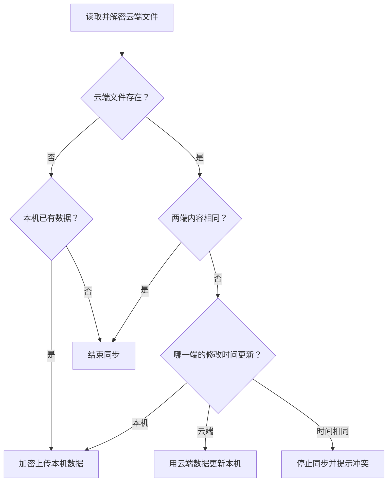

# 资产簿

[返回项目首页](../../README.md) · 默认地址：`/pwa-apps/assets/`

账户当前余额与月度报表保存在当前浏览器的 IndexedDB。新建账户时分别录入机构或资产名称、资产或负债分类和资金可用性。同一机构下可有多个账户；银行存款按资金可用性区分活期与定期；首页的“已记录流动资金”只汇总标记为“流动资金”的资产最近余额。账户资料可在详情中修改；归档保留月度报表，并从归档当天起退出当前合计。资产与负债都以非负余额录入；计算净资产时扣除负债。目前金额统一按人民币处理。

## 使用与历史计算

- 可以单独更新余额，也可以通过资产盘点集中更新；每个账户只保留一条当前余额，更新时直接覆盖。
- 趋势与日期对比使用目标日期之前每个账户最后一条余额。缺少账户记录的期间不会显示完整增长结论。沿用余额是估算，不代表资产市值没有变化。
- 资产盘点会把核对、变更和跳过结果直接写入当月报告，不另外保存盘点历史。
- 本机目前只有一份 IndexedDB 数据，不按云端名字切换本地档案。

## 月度报告

录入、修改余额或完成盘点后，按月份生成或更新本地报告并随加密备份同步。每个月最多一条报告，最多保留最近 120 份；生成第 121 份时自动删除最早的一份。没有余额更新或盘点的月份不会生成报告。报告是独立快照，包含总资产、负债、净资产、流动资金、完整性、盘点结果以及各账户当时的金额；后续更新当前余额不会重算过去月份。完成盘点会覆盖本月报告中的上一次盘点结果，不保留独立盘点记录。

## 配置 GitHub 访问

先创建私有仓库 `liuzhenghua/pwa-apps-data`。资产簿把加密数据写在 `assets/<名字>/portfolio.json`；名字支持字母、数字、下划线和连字符。不同名字区分云端文件夹，不是访问控制。

Token 需要对该仓库的 **Contents: Read and write** 权限。可以在页面首次输入并保存在当前浏览器，或按[构建时配置加密 Token](#构建时配置加密-token)启用云端访问口令。

点击「立即同步」后，应用按**整份数据**比较内容和最后修改时间。

同步需手动触发。修改时间取自设备时钟。GitHub 文件 SHA 用于检测同步期间的云端变化。多设备分别修改账户时使用整份数据更新。

旧版本固定路径 `assets/portfolio.json` 可在备份弹窗中读取并恢复；新备份只写入带名字的目录。导出加密 JSON 文件可用作独立备份。

## 构建时配置加密 Token

笔记、资产簿与股票账簿共用同一份加密 Token。生成密文、本地 `.env.local` 和 GitHub Actions Secret 的完整步骤见[根 README](../../README.md#云端数据与加密-token-配置)。配置后页面只需输入云端访问口令；未配置时仍可手动输入 Token。

## 加密方案

资产数据与 GitHub Token 使用**两个独立的口令和密文**：

- 备份口令在浏览器内经 PBKDF2-HMAC-SHA-256（600,000 次迭代、16 字节随机 salt）派生 AES-256-GCM 密钥。每次导出或上传使用新的 12 字节 IV，密文文件保存版本、salt、IV 和 ciphertext。备份口令可在当前浏览器保存；丢失后无法解密资产备份。
- 构建时 Token 由[通用生成脚本](../../scripts/encrypt-github-token.mjs)用另一段云端访问口令、独立随机 salt 和 IV，按同样的 PBKDF2 与 AES-GCM 算法加密。构建产物包含 Token 密文；浏览器输入云端访问口令后才解密为 Token。解密算法见[共用 token-box.ts](../../packages/shared/src/token-box.ts)。

AES 加密保护明文，但**不保护密文免遭删除或替换**。如果云端访问口令被猜出，持有解密后 Token 的人就能按该 Token 的权限读写私有仓库文件。备份内容的格式与 GitHub 读写实现见 [backup.ts](src/backup.ts)，本地历史计算见 [data.ts](src/data.ts)。

通用启动与部署步骤见[项目 README](../../README.md#本地启动)。
