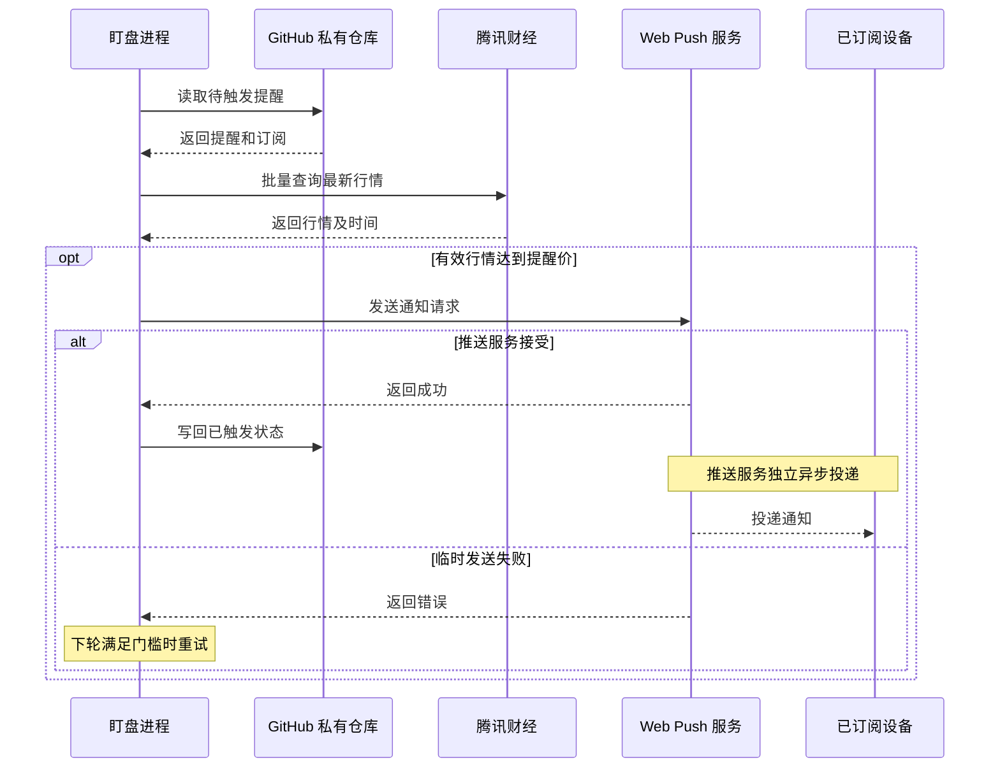

# 股票账簿

输入沪深 A 股代码添加股票，查看最新行情，记录并复盘做 T 周期。

## 运行与安装

需要 Node.js 22 和 npm。在仓库根目录安装依赖并启动。

```sh
npm ci
npm run dev:stocks
```

开发地址以 Vite 输出为准，默认应用路径为 `/pwa-apps/stocks/`。检查与构建命令见[项目 README](../../README.md#本地启动)。完整构建输出位于 `dist/`，其中 `dist/stocks/` 是股票账簿。使用项目 GitHub Pages 部署，或在 HTTPS / localhost 下按构建路径提供静态文件。首次在线打开构建后的应用后，可通过浏览器菜单安装。缓存就绪后可离线记录和测算。

## 行情和价格记录

- 首页打开或切回前台时查询腾讯财经公开行情，前台每 30 秒更新，也可以手动刷新。页面显示行情源的时间，休市时为上一次有报价的时间。
- 点击「记买价」或「记卖价」，填写价格和股数。最新价会自动带入，也可手动修改。点金额标签可按表单价格换算成最接近的百股整数倍，使用加减按钮每次调整 100 股。应用保存录入时间。持仓卡片默认显示当前周期内最近三笔买入和卖出，可以展开当前周期的全部记录，交易页保留完整流水。
- 录入卖价时会与本周期内最近三笔买价分别对比，显示价差盈亏和收益率。每笔按买卖股数中较少的一方估算，买入股数未知时使用卖出股数。
- 旧版有成交记录的股票会显示原先最近三个买卖订单的成交单价和数量，多笔成交的单价按数量加权。原交易数据保留在备份中。
- 可离线记价格。行情查询需要联网，刷新失败时显示提示和本次打开以来已取得的最后报价。

## 做 T 周期

股票详情里可以结束本次周期，即使还有未配对股数。下一笔交易开始新周期，原交易流水及交易页持仓统计继续保留。

「收益」默认查看今年，已结束周期可按年切换，进行中的周期单独展示。展开周期可查看逐笔记录。周期内按成交时间处理记录。卖出优先扣减最近一笔仍有剩余的买入，先卖后买仍按卖出顺序配对。旧版已结束周期沿用原来的配对方式。收益按配对价差计算，未配对股数单独显示，费用未扣除。交易页的持仓统计仍按最低买入价优先扣减。

持仓卡片显示当前周期未配对买入的股数和加权平均成本，并按最新价估算全部卖出的价差收益及收益率。买入测算显示以最新价买入同样股数时的金额差和百分比。有进行中周期时对比本周期最近一笔买入，无周期时对比最近一笔卖出。观察阈值只决定标签是否显示。

在设置的「买卖观察规则」中可调整门槛和复合条件。买入与卖出观察独立计算，可以同时出现。

| 场景 | 比较基准 | 默认变动门槛 |
| --- | --- | --- |
| 周期内买入观察 | 本周期最近卖价 | 回落 1% |
| 周期内买入观察 | 本周期最近买价 | 回落 2% |
| 无周期时买入观察 | 历史最近卖价 | 回落 2% |
| 卖出观察 · 全部剩余股数 | 本周期剩余均价 | 上涨 2% |
| 卖出观察 · 最近剩余批次 | 最近一笔仍有剩余的买价 | 上涨 1% |

周期内买入观察默认满足任一门槛即可触发。卖出观察默认也采用任一条件，优先提示全部剩余股数，其次提示最近剩余批次。

## 本机备份

交易与关联数据保存在 IndexedDB。设置中的「导出」会下载完整的 JSON 账簿，包含未加密的股票和价格记录。如有未下载的往年归档，导出前会联网补齐。「导入」会验证数据格式和批次关系，并在确认后替换本机记录。清空本机需要两次确认。清理浏览器数据会移除本机记录，已导出的文件和已有云端备份仍可用于恢复。

## GitHub 加密同步

1. 创建私有数据仓库 `liuzhenghua/pwa-apps-data`，在默认分支完成初始提交，并按[通用配置](../../README.md#云端数据与加密-token-配置)生成加密 Token。
2. 在「设置 → 同步配置」填写云端名字、云端访问口令和数据加密口令，再点击「保存并同步」。已有 `personal` 备份时填原名字。
3. 在其他设备使用相同的名字和数据加密口令。保存完整配置后，应用在线启动时会自动同步一次，也可使用「立即同步」。

口令可在当前浏览器的同步配置中清除。两端都有修改时，在设置中选择保留哪一端。缺少加密 Token 时可继续在本机使用账簿。

应用使用 PBKDF2-SHA256 派生 AES-GCM 密钥，在浏览器内加密索引和数据文件。云端文件存放在同名目录下。

| 文件 | 内容 |
| --- | --- |
| `open.json` | 股票资料、规则、年度索引和未结束周期。跨年的进行中周期也留在这里 |
| `year-<年份>.json` | 按北京时间的周期结束年份归档，保留逐笔交易 |

旧版 `ledger.json` 及带版本后缀的归档均可读取。下次写入时会将索引合入 `open.json`，并在同一提交移除 `ledger.json`。旧索引仍可在 Git 历史中恢复，已有带后缀的归档保留。数据仓库的默认分支需要先有一次初始提交，且允许 Token 更新。迁移后各设备需用新版应用同步。

| 操作 | 读取或写入的范围 |
| --- | --- |
| 日常同步 | 先核对 `open.json`，复用校验值一致的文件，只下载变化的当前年份或进行中数据，只上传变动文件 |
| 新设备首次同步 | 下载进行中数据和今年已结束周期 |
| 在「收益」中选择往年 | 下载该年并在本机缓存 |
| 交易页点击「下载全部历史」 | 补齐往年流水和全历史持仓统计 |
| 结束周期后同步 | 按周期结束年份写入归档 |

加载往年数据时按本机已同步的提交读取。单个加密文件超过 950 KB 时停止发布并保留本机和云端数据。同步把索引与本次变动放在同一个 Git 提交中，最后以非强制方式更新默认分支。写入中断或遇到更新的远端提交时，原备份仍可读取。

## 股票价格提醒

持仓卡右上角的铃铛会打开当前股票的提醒列表。底部点「买入」或「卖出」可打开对应的提醒价表单，参考最新价、近期成交或周期剩余成本。可选当前价、最近买价、最近卖价或周期剩余均价，再用百分比输入框和加减按钮计算提醒价。提醒价也可直接填写。保存时会检查此设备的通知权限和推送绑定。未启用时可开启通知，也可确认「仍然保存」，稍后在同一设备启用。已填写的价格会保留。同一只股票可以添加多条。

「设置 → 价格提醒」汇总所有设备已设置的提醒，显示方向、价格、触发状态和设备归属。当前设备可重新启用或移除自己的提醒，也可在这里查看开启通知的步骤。

交易时段内，最新价小于或等于买入提醒价，或大于或等于卖出提醒价，就发送一次通知。登记时已经达到条件的提醒，会在下次取得有效行情时触发。触发后可在列表中重新启用或移除。

### 初始化盯盘电脑

需要 Node.js 22.13 或更新版本。在仓库根目录执行，复制模板后先填写配置，再运行初始化。

```sh
npm ci
cp apps/stocks/.env.stock-alerts.example apps/stocks/.env.stock-alerts
# 填写配置后初始化
npm run stocks:alerts -- --init
```

| 配置项 | 用途与要求 |
| --- | --- |
| `STOCK_ALERTS_GITHUB_TOKEN` | 对私有数据仓库有 Contents 读写权限的 Token |
| `STOCK_ALERTS_KEY_SECRET` | 用密码管理器生成并保存的强随机口令，用于加密和恢复推送私钥 |
| `STOCK_ALERTS_SUBJECT` | VAPID 联系方式。使用模板格式，邮箱保留 `mailto:` 前缀 |
| `STOCK_ALERTS_CLOSED_DATES` | 可选。工作日休市日期，格式为 `YYYY-MM-DD`，以逗号分隔。修改后重启程序 |

实际配置文件已被 Git 忽略。首次初始化将公钥与加密私钥写入 `stock-alerts/alerts.json`。重复运行会核验并保留现有密钥。

### 家人在 iPhone 上绑定并测试

1. 通过项目的 GitHub Pages 发布包含本功能的版本。在 iOS 16.4 或更新版本用 Safari 打开 HTTPS 版股票账簿，选择「添加到主屏幕」，再从主屏幕打开。
2. 在「设置 → 同步配置」填写云端访问口令。打开持仓卡的铃铛，点「启用通知」，允许系统通知，然后添加价位。每台设备管理自己的提醒，即便使用同一个账簿云端名字。iPhone 通过 GitHub 登记，公司电脑无需开放端口。
3. 在公司电脑运行 `npm run stocks:alerts -- --test`，给当前所有已绑定设备发送测试通知。这条命令不受交易时段限制。终端会显示推送服务接受了几台设备的请求。可锁屏检查实际到达情况。

### 启动日常盯盘

在公司电脑的仓库根目录运行以下命令，保持终端打开并让电脑保持联网、唤醒。

```sh
npm run stocks:alerts
```

程序按北京时间在工作日的 09:30–11:30 和 13:00–15:00 每分钟批量查询一次已订阅股票。它使用腾讯财经行情，跳过不在当日当前交易时段或超过两分钟的报价。每分钟轮询可能错过分钟内的短暂触价。公司网络需能访问 `api.github.com`、`qt.gtimg.cn` 和 iPhone 的 `*.push.apple.com`。按 `Ctrl+C` 停止。换电脑时关闭旧进程，在新电脑安装依赖并配置 GitHub Token、同一个 `STOCK_ALERTS_KEY_SECRET` 和联系邮箱，再运行日常启动命令。程序会从 GitHub 取回原推送密钥，家人的 iPhone 无需重新绑定。全家只需运行一个盯盘进程。

日常提醒的发送顺序如下。



若在发送成功和写回 GitHub 之间进程退出，同一条提醒在重启后可能再次发送。提醒规则和设备绑定以明文存放在 GitHub 私有仓库，同仓库的读写权限也适用于这些数据。推送私钥单独加密，已有账簿及备份仍使用各自的数据加密口令。旧单用户版本的提醒如已登记，请在家庭版重新添加。
